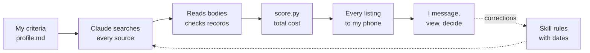

# vancouver-room-hunt

How I found a room share in Vancouver as a newcomer, with Claude Code as my housing
scout. I arrived on a working-holiday visa at the end of August 2026 with no job and no
Canadian credit history, and needed a room from October 1. In under three weeks from
the first price map to a signed agreement, Claude read hundreds of listings across eight
sources and checked addresses against public records. I viewed seven rooms and signed one.

This repo keeps two things: the Claude Code skill that did the scouting, and the know-how
and experiences behind every rule in it, in [FIELD-NOTES.md](FIELD-NOTES.md).

## How it works

1. **I set the criteria; Claude writes them down with the date.** A private `profile.md`
   holds my anchor (the central library), move-in date, term, knockouts and ranking.
   They changed five times in two weeks, so Claude asks again when they start to tangle
   instead of searching on yesterday's filter.
2. **Claude searches every live source on every run.** Craigslist, Facebook Marketplace
   and groups, Kijiji, Rentals.ca and the Korean community boards. It uses curl and JSON
   APIs where they exist and a browser where they do not. It reads Facebook through my
   own logged-in Chrome, read-only. Every report ends with what each source returned and
   what blocked it.
3. **Claude reads the body of every post, not the card.** Gender rules, living-room
   occupants, utilities and lease terms are below the fold. Knockouts are facts only;
   everything else is scored.
4. **Claude checks the address before I spend a trip on it.** BC Assessment for the real
   bedroom count, floors and basement. The distance to the SkyTrain track, not the
   station. Crime data with its limits stated. For a finalist, an LTSA title search, so
   the owner, the landlord on the agreement and the payee can be matched.
5. **Code does the arithmetic.** `score.py` prices each room as rent + utilities +
   transit (+ furniture), and with a budget file shows my balance with and without a job.
6. **Every listing goes to my phone, not just the shortlist.** One line each, with a
   link. Two of the three rooms I picked from the first such list were ones Claude had
   not recommended.
7. **I do everything that talks to a person or moves money.** Claude drafts enquiries,
   viewing questions and contract checks. I edit and send every message, go to every
   viewing, sign, and pay.
8. **Claude keeps the record.** A living ledger with every message sent and received
   verbatim, an archive of each shortlisted post, and a re-fetch and diff of a post the
   day before its viewing.
9. **Every correction goes into the skill the same day,** with the date and the
   incident behind it, so the next session starts from the corrected rule.



## Design choices

- **Claude never contacts, posts, joins, signs or pays.** Joining a group exposes my name
  to tens of thousands of people, and a message is my voice. Claude drafts; I send.
- **Total monthly cost, not rent.** A monthly pass limits zones on SkyTrain only and buses
  are unlimited everywhere, so a far-out room on a bus route costs the same pass as a
  central one. Compared on rent alone, the ranking flipped often.
- **Records live outside the chat**, in storage I can read from my phone. Posts get edited
  and deleted: one shortlisted listing vanished and survived only in the archive, and a
  re-fetch caught a move-in date quietly changed after a phone call.
- **The law is read from the statute.** The Residential Tenancy Act sections that decide a
  room renter's status are cited in `skill/references/bc-tenancy.md`.
- **My constraints stay private.** The skill reads them from a gitignored `profile.md`;
  this repo has only the generalized method.
- Python standard library only. 23 offline tests for the scripts, and a privacy guard with
  its own tests in the hooks and CI.

## What broke, and what changed

Each of these happened during the search and is now a rule in the skill.

- **Claude suggested sending a deposit to hold a room before a viewing.** That is the
  rental scam's whole mechanism. Now: the scam tell is "no viewing", and nothing is paid
  before the unit is seen.
- **It searched one site and called it a search.** The other sources had rooms Craigslist
  never did. Now: every source, every run, with a coverage line.
- **It dropped a listing because the current housemates were women**, though the ad had no
  rule. Now: only the ad's own restriction filters.
- **It described a room as "600 m from SkyTrain".** The elevated track was 29 m from the
  building. Now: measure the distance to the track.
- **It logged a host's "just tell me a day before you leave" as one-day eviction.** It was
  flexibility for me. Now: record whose obligation a term is, and label any reading as
  inference.
- **It read a flowerbed at eye level as "ground floor".** It was a basement. Now: check the
  storeys and basement area on BC Assessment first.
- **It blamed my first cold viewing on too many questions.** I had not asked them; the host
  wanted proof of funds. Now: ask what happened before explaining why, and bring proof of
  funds.
- **It took "I don't mind a long ride" as "I want the suburbs".** Ten of my thirteen own
  picks were downtown. Now: stated tolerance is not preference.
- **Its comparison tables had no column for how I wanted to live.** House rules and a
  lived-in feel decided my first choice. Now: name those as real factors.
- **The decision interview's top two choices both fell through within a day.** I signed the
  room I had chosen first, which was safe only because every finalist had been checked to
  the same depth. Now: keep the second choice open until the first is signed.

The full story of each, and the rest of the know-how, is in [FIELD-NOTES.md](FIELD-NOTES.md).

## What is inside

- [`FIELD-NOTES.md`](FIELD-NOTES.md): the search as it happened, from what a room really
  costs to the three finalists, the decision and the contract
- [`skill/SKILL.md`](skill/SKILL.md): the Claude Code skill, readable as a guide on its own
- [`skill/references/`](skill/references/): `sources.md` (fifteen sources audited, with URL
  patterns, APIs and rate limits), `checks.md` (BC Assessment, LTSA, VPD crime data,
  routing, OpenStreetMap), `bc-tenancy.md`, `viewing.md` (noise tests, photos, Korean-board
  room names), `vancouver-geo.md` (zones, walking radius, the ten blocks to avoid, prices)
- `skill/scripts/`: `score.py` (total cost and budget runway), `stations.py` (nearest of all
  53 SkyTrain stations), `naver_cafe.py` (Naver cafe room boards without a browser)
- `guard/`: the privacy guard that keeps personal details out of this repo

## Run it

```bash
python3 -m unittest discover -s skill/tests
python3 skill/scripts/score.py --batch skill/examples/listings.example.json \
                               --budget skill/examples/budget.example.json
```

To use the skill, copy `skill/` to `~/.claude/skills/room-hunt/`, copy
`profile.example.md` to `profile.md` and fill it in, then ask Claude Code to find you a
room or paste a listing. Vancouver and BC only; fares were checked on 2026-09-10 and rise
every July 1; sites change their markup; nothing here is legal advice.

## Privacy

The real search's records (messages, names, addresses, contracts, money) stay private.
`guard/check_public.py` blocks Korean text, email addresses, phone numbers, amounts in won,
links outside an allowlist of public sources, a private list of names and places, files it
cannot read as text, and any path outside the expected layout. Room prices and fares in CAD
are allowed because they are public market data. It runs in the pre-commit, commit-msg and
pre-push hooks (`sh guard/install-hooks.sh` once per clone) and in CI on every commit of a
push or pull request.

## License

MIT
